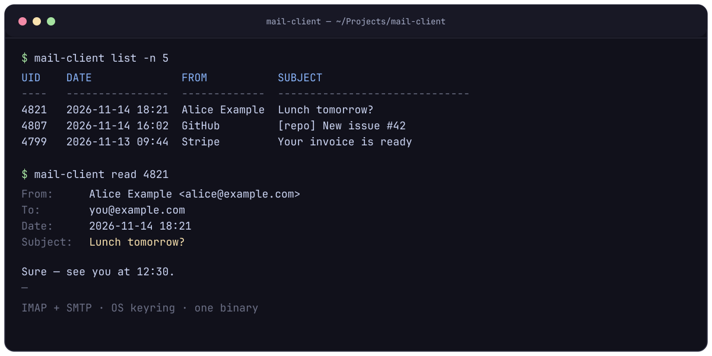

# Mail Client

A small, command-based email client for the terminal. It speaks IMAP and SMTP,
so it works with Gmail, Fastmail, iCloud, Yahoo, self-hosted mail, and any other
provider that supports app passwords or password authentication.



## Why

The Gmail API requires a Google Cloud OAuth project. IMAP and SMTP with a Gmail
app password do not. That makes this usable when Cloud Console is unavailable,
and it keeps the same client working across providers instead of locking it to
one company.

There is one binary and one project. No separate Gmail client, no TUI, no GUI.

## How it works

1. Accounts live in `~/.config/mail-client/config.json`; passwords live in the
   operating system's keyring, not in that file.
2. IMAP is used for listing, searching, reading, folders, flags, moves, and
   trash. TLS is verified by default; STARTTLS and plain TCP are available for
   custom or local servers.
3. `list` and `search` remember the mailbox they used. `read`, `reply`,
   `attachments`, `attachment`, and `mark` use that mailbox automatically, so
   Gmail All Mail UIDs keep working after a search.
4. Reading marks a message as seen. `--no-mark-read` opts out.
5. MIME is parsed locally. HTML-only mail is converted to clean text; charset
   handling, RFC 2047 headers, and base64/quoted-printable parts are decoded.
6. Sending and replying go through SMTP. Bcc addresses are used for the
   envelope only and are never written into message headers.
7. Provider presets supply the usual hostnames and folder names. Gmail's
   localized folders are discovered through IMAP special-use flags instead of
   hard-coded English names.

## Usage

### Gmail setup

1. Enable 2-Step Verification.
2. Create an app password at <https://myaccount.google.com/apppasswords>.
3. Add the account:

```bash
mail-client account add --email you@gmail.com
mail-client account test
mail-client list
```

Use the 16-character app password, not the normal Google password. If the app
password page is unavailable, 2FA is off, 2FA only uses security keys, Advanced
Protection is enabled, or a Workspace administrator disabled app passwords.

### Commands

| Command | What it does |
| --- | --- |
| `mail-client account add` | Add or update an account |
| `mail-client account list` | Show configured accounts |
| `mail-client account test` | Check IMAP and SMTP |
| `mail-client account password` | Store a new password in the keyring |
| `mail-client account remove` | Remove an account and its keyring entry |
| `mail-client list` | List the current mailbox |
| `mail-client search` | Gmail search syntax, or IMAP criteria elsewhere |
| `mail-client read` | Read a message and list attachments |
| `mail-client send` | Send mail, with HTML and attachments |
| `mail-client reply` | Reply or reply-all |
| `mail-client attachments` | List attachment numbers |
| `mail-client attachment` | Download one attachment |
| `mail-client folders` | List, create, rename, or delete folders |
| `mail-client move` | Move messages to another folder |
| `mail-client archive` | Remove messages from the inbox |
| `mail-client trash` | Move messages to trash |
| `mail-client mark` | Mark read/unread or star/unstar |

### Examples

```bash
mail-client list -n 20
mail-client list -m Archive
mail-client list --unread

mail-client search 'from:abertay has:attachment'
mail-client search --from alice --subject invoice --since 2026-01-01

mail-client read 4821
mail-client read 4821 --html
mail-client read 4821 --format json
mail-client read 4821 --format raw

mail-client attachments 4821
mail-client attachment 4821 1 --output ~/Downloads/invoice.pdf

mail-client send --to alice@example.com -s 'Hello' -b 'From the terminal.'
mail-client reply 4821 --all -b 'Sounds good.'
```

Multiple UIDs can be passed with spaces or commas:

```bash
mail-client trash 4821 4822 4823
mail-client trash 4821,4822,4823
```

Gmail searches use `[Gmail]/All Mail` by default. Other mailboxes can be
selected with `--mailbox`. The mailbox is remembered, so a UID from a search can
be passed straight to `read`, `reply`, `attachments`, or `mark`.

### Output

- `table` for people
- `plain` for `cut`, `awk`, and `fzf`
- `json` for scripts

```bash
mail-client list --format json | jq -r '.messages[].uid'
mail-client list --format plain | cut -f1
```

## Installation

**Requirements:** Rust 1.85+, a C toolchain, OpenSSL, and an unlocked Secret
Service / KWallet / Keychain / Credential Manager for password storage.

```bash
git clone https://github.com/batusaribay/mail-client.git
cd mail-client
cargo build --release
cargo install --path . --locked
```

The binary is installed as `mail-client`.

Shell completions are generated for the current `$SHELL`, or for a named shell:

```bash
mail-client completions bash > ~/.local/share/bash-completion/completions/mail-client
mail-client completions zsh > ~/.zfunc/_mail-client
mail-client completions fish > ~/.config/fish/completions/mail-client.fish

# detected from $SHELL, printed to stdout
mail-client completions
```

## Configuration

| Path | Purpose |
| --- | --- |
| `~/.config/mail-client/config.json` | Accounts, servers, folder names, current mailbox |
| OS keyring (`mail-client`) | Account passwords |

Environment variables:

| Variable | Purpose |
| --- | --- |
| `MAIL_CLIENT_CONFIG_DIR` | Alternate config directory |
| `MAIL_CLIENT_ACCOUNT` | Default account selector |
| `MAIL_CLIENT_PASSWORD` | Password override; bypasses the keyring |

Accounts can also be kept separate with `--config-dir`. To use a custom server:

```bash
mail-client account add \
  --email me@example.org \
  --preset custom \
  --imap-host imap.example.org --imap-port 993 --imap-tls tls \
  --smtp-host smtp.example.org --smtp-port 587 --smtp-tls starttls
```

If a folder name is unusual, override it with `--trash-mailbox`,
`--archive-mailbox`, `--sent-mailbox`, and related options.

## Security

- Passwords are stored in the OS keyring, never in `config.json`. The config
  directory is `0700` and the file is written atomically with mode `0600`.
- Older plaintext passwords are migrated to the keyring on first run.
- TLS certificates are verified. `none` is available only as an explicit choice
  for local relays.
- Bcc addresses are omitted from message headers.
- Outgoing headers are stripped of CR/LF, and attachment filenames are
  sanitized before use as local paths.
- Text output strips terminal control characters.
- No telemetry, analytics, or background polling.

An app password grants full mailbox access. Revoke it from your provider if a
machine is lost, and prefer a provider app password over your account password.

## Files

```
src/main.rs      CLI dispatch and command handlers
src/cli.rs       clap command and argument definitions
src/config.rs    accounts, servers, presets, config persistence
src/secrets.rs   OS keyring access
src/imap.rs      IMAP listing, search, read, folders, flags, moves
src/smtp.rs      SMTP send and connection test
src/mime.rs      MIME generation, HTML-to-text, header encoding
src/render.rs    table, plain, and JSON output
src/presets.rs   Gmail, Outlook, Yahoo, iCloud, Fastmail defaults
src/model.rs     shared message, attachment, folder, and result types
```

## Development

```bash
cargo fmt --check
cargo clippy --all-targets -- -D warnings
cargo test
cargo build --release
```

The test suite includes mock IMAP and SMTP servers, so search, fetch, HTML
conversion, attachments, send, and reply can be exercised without a live inbox.

## Known issues

- No conversation/thread view, drafts, contacts, or calendar yet.
- No permanent-delete command; trash is reversible.
- Outlook/Microsoft 365 commonly requires OAuth for IMAP/SMTP.
- Move and trash need IMAP UIDPLUS.
- Self-signed TLS certificates are not bypassable.
- Text mode renders HTML-only mail as plain text; use `--html` or JSON when the
  original markup matters.

## Future ideas

- Thread grouping and a draft workflow
- Optional local message cache
- OAuth support for providers that no longer allow app passwords
- Per-account signatures and send-as aliases

## License

This project is licensed under the [MIT License](LICENSE).
